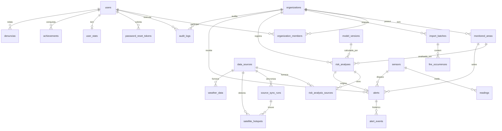

# 09 — Banco de dados: diagnóstico e plano de migrações

Auditoria em 16/11/2026 sobre o banco de desenvolvimento (PostgreSQL 16.15) com as migrações `0000`–`0003` aplicadas. **Nenhuma alteração foi feita no banco nesta etapa.**

## 1. O prompt e o estado atual do repositório

Alguns pontos do prompt descrevem uma versão anterior do código:

| Premissa do prompt | Situação real |
|---|---|
| "`shared/schema.ts` define 13 tabelas" | São **19** (+ `session`, criada pelo `connect-pg-simple`). As 13 originais estão preservadas; as 6 novas vieram da migração `0002` (organizações, membros, eventos de alerta, auditoria, tokens) e `0003` (publicação de lotes). |
| `CeresMaps.tsx` usa `DEMO_AREAS` | Já substituído: o mapa (`client/src/pages/EnvironmentalMap.tsx`) lê áreas e ocorrências reais da API. Dados demonstrativos só via `npm run db:seed-demo`, com rótulo "[DEMO]" e bloqueado em produção. |
| `server/storage.ts` cai para memória | Já corrigido: o fallback em memória só existe com `STORAGE_MEMORY_FALLBACK=true` e **nunca** em produção. |
| Isolamento entre organizações | Já implementado nas tabelas do núcleo e coberto por 30 testes de integração. |

## 2. Inventário

### 2.1 As 13 tabelas originais

| Tabela | Papel | Escopo de organização | Observações da auditoria |
|---|---|---|---|
| `users` | contas | — (via `organization_members`) | `email` único; senha bcrypt |
| `user_stats` | gamificação | não | **sem FK** para `users`; sem `UNIQUE(user_id)` (permite duplicar) |
| `achievements` | gamificação | não | **sem FK**; sem unicidade `(user_id, badge_id)` |
| `denuncias` | relatos | não | **sem FK** `user_id`; coordenadas sem `CHECK`; listagem restrita a `platform_admin` |
| `sensors` | sensores | **não** | coordenadas `real` sem `CHECK` |
| `readings` | leituras | **não** | **sem FK** `sensor_id`; sem índice `(sensor_id, timestamp)` |
| `weather_data` | clima | **não** | sem origem, sem horário da observação vs. obtenção, sem distinção observação/previsão; não é usada como cache |
| `monitored_areas` | áreas | sim | **sem FK** `created_by` |
| `risk_analyses` | análises | sim | **sem FK** `area_id` e `created_by`; versão do modelo só em texto |
| `alerts` | alertas | sim (novos) | **sem FK** `sensor_id` |
| `data_sources` | fontes | não | tabela vazia; o registro real de conectores está fixo no código (`/api/connectors`) |
| `import_batches` | lotes | sim | **sem FK** `imported_by` |
| `fire_occurrences` | ocorrências | sim | data e hora em **texto**; sem código IBGE; sem deduplicação entre lotes; sem índice por data/município |

### 2.2 Problemas transversais

| # | Problema | Evidência | Risco |
|---|---|---|---|
| B1 | **11 colunas de referência sem chave estrangeira** (`readings.sensor_id`, `alerts.sensor_id`, `user_stats.user_id`, `achievements.user_id`, `denuncias.user_id`, `monitored_areas.created_by`, `risk_analyses.area_id`, `risk_analyses.created_by`, `import_batches.imported_by`…) | `pg_constraint` | órfãos silenciosos; exclusões inconsistentes |
| B2 | **26 colunas `timestamp` sem fuso** | `information_schema` | ambiguidade se o fuso do servidor mudar; o código grava em UTC |
| B3 | `occurrence_date` e `occurrence_time` em texto | idem | filtros por período dependem de comparação de strings (funciona só porque a importação normaliza para ISO desde a v. anterior) |
| B4 | Coordenadas em `real` (float4, ~7 dígitos) | idem | perda de precisão de até cerca de 1 m; `double precision` é o padrão |
| B5 | Sem deduplicação entre lotes | não há chave | o mesmo arquivo importado duas vezes duplica ocorrências |
| B6 | Sem índices para as consultas reais de ocorrências (data, UF/município, lote) | `pg_indexes` | varredura completa à medida que os dados crescem |
| B7 | Sem PostGIS; proximidade calculada com haversine na aplicação | `artemis-routes.ts` | aceitável para milhares de linhas, não para milhões de focos de satélite |
| B8 | `server/db.ts` e `drizzle.config.ts` **priorizam `SUPABASE_DATABASE_URL`** sobre `DATABASE_URL` | código | na VPS, uma variável antiga do Supabase redirecionaria a produção para o banco errado |
| B9 | O usuário da aplicação é dono do schema e tem `CREATEDB`; a API executa migrações e cria a tabela `session` em tempo de execução | `pg_roles`, `server/app.ts` | privilégio excessivo em produção |
| B10 | `npm run db:push` aplica o schema direto, sem migração revisável; snapshots do Drizzle pararam em `0001` (0002/0003 escritas à mão) | `package.json`, `migrations/meta` | `db:push` em produção poderia alterar ou apagar colunas |
| B11 | Listagens usam só `LIMIT` fixo (500/5000), sem paginação | rotas | resposta truncada sem aviso |
| B12 | Sensores, leituras e clima não têm escopo de organização | schema | hoje mitigado (escrita só `platform_admin`), mas impede uso por cliente |
| B13 | Falha da importação no meio do lote: código usa transação única, **sem teste** que prove o rollback | testes | regressão silenciosa possível |

Verificação de pré-condição: **0 registros órfãos** nas colunas que receberão FK, **0 datas fora do ISO** e **0 duplicatas** entre lotes no banco de desenvolvimento. As consultas de verificação entram na própria migração (ela aborta, sem alterar nada, se encontrar órfãos).

## 3. Diagrama entidade-relacionamento (estado após o plano)

`fire_occurrences` (registros históricos importados, ex. Sisfogo) e `satellite_hotspots` (focos de calor, ex. INPE) ficam **em tabelas separadas**. A consulta combinada usa uma *view* com a coluna `origem`, sem misturar os dados na gravação.

## 4. Plano de migrações

Princípios: somente aditivas; nenhum `DROP TABLE`, `DROP COLUMN` ou `TRUNCATE`; cada migração em transação única; testada em banco de desenvolvimento e numa cópia restaurada de backup antes de qualquer produção.

### 0004 — Integridade (corrige B1, B2, B4, B13)

| Alteração | Regra de exclusão | Motivo |
|---|---|---|
| FK `readings.sensor_id → sensors` | CASCADE | leitura não existe sem sensor |
| FK `alerts.sensor_id → sensors` | SET NULL | alerta permanece como histórico |
| FK `user_stats.user_id → users` + `UNIQUE(user_id)` | CASCADE | 1 registro por usuário |
| FK `achievements.user_id → users` + `UNIQUE(user_id, badge_id)` | CASCADE | conquista não duplica |
| FK `denuncias.user_id → users` | SET NULL | relato permanece, anonimizado |
| FK `monitored_areas.created_by`, `risk_analyses.created_by`, `import_batches.imported_by → users` | SET NULL | preserva registros se a conta for excluída (LGPD) |
| FK `risk_analyses.area_id → monitored_areas` + coluna `area_snapshot` (nome, município, UF, coordenadas no momento da análise) | SET NULL | hoje excluir a área deixa um id pendurado; com o snapshot, a análise continua rastreável |
| `timestamp` → `timestamptz` (26 colunas), interpretando os valores atuais como UTC | — | sem perda; elimina ambiguidade de fuso |
| `real` → `double precision` nas coordenadas e medições | — | ampliação sem perda |
| `CHECK` de faixa de coordenadas em `sensors`, `denuncias`, `weather_data`, `fire_occurrences` | — | coerente com as já existentes |

Cada FK é criada como `NOT VALID` e depois validada (`VALIDATE CONSTRAINT`), após uma verificação de órfãos que aborta a migração com mensagem clara. Nada é apagado.

### 0005 — Ocorrências, deduplicação e índices (B3, B5, B6, B11)

- `fire_occurrences`: novas colunas `occurred_on date` e `occurred_hour smallint`, preenchidas a partir do texto (os campos originais `occurrence_date`/`occurrence_time` continuam intactos); `municipality_ibge_code` (nulo até haver tabela oficial de municípios); `dedup_key` (data + município normalizado + coordenadas arredondadas + tipo).
- Índice único parcial `(organization_id, dedup_key)` para registros válidos. Na importação, uma ocorrência que já existe em outro lote da mesma organização passa a ser contada como **duplicado**, com motivo no relatório, e nunca é descartada em silêncio.
- Índices: `(organization_id, occurred_on)`, `(state, lower(municipality))`, `(import_batch_id)`, `alerts(area_id)`, `readings(sensor_id, timestamp)`.
- Paginação com `limit`/`offset` e cabeçalho `X-Total-Count` em `GET /api/fire-occurrences` e `GET /api/alerts`. **O corpo continua sendo um array**, então os consumidores atuais não quebram.
- Nova tabela `municipalities` (código IBGE, nome, UF), carregada a partir de arquivo oficial do IBGE versionado no repositório. Depende de acesso ao IBGE ou de o arquivo ser fornecido.

### 0006 — Fontes, sincronização, focos de calor e clima (Etapa 3)

| Tabela | Justificativa | Sem duplicar |
|---|---|---|
| `data_sources` (existente, ampliada) | `key` única, URL, licença, método de acesso, periodicidade, se é oficial; passa a alimentar `/api/connectors` em vez da lista fixa no código | reaproveita a tabela vazia existente |
| `source_sync_runs` | registro de cada sincronização: início/fim, status, lidos/inseridos/duplicados, erro, parâmetros — exigido para proveniência e tratamento de falhas | — |
| `satellite_hotspots` | focos de calor (INPE): `external_id`, satélite, `detected_at`, coordenadas, município/UF/bioma, atributos originais em `raw`, `sync_run_id`; `UNIQUE(source_id, external_id)` para sincronização incremental | separada de `fire_occurrences`: foco ≠ incêndio confirmado |
| `weather_data` (existente, ampliada) | `source_id`, `kind` (`observacao`/`previsao`/`historico`), `observed_at`, `fetched_at`, `precipitation_72h`; unicidade por fonte + tipo + coordenada arredondada + horário. Passa a servir de **cache** do Open-Meteo (validade de 30 min), reduzindo chamadas externas | reaproveita a tabela existente |
| *view* `v_fire_events` | união de ocorrências importadas e focos de calor com a coluna `origem`, para consultas combinadas | só leitura |

### 0007 — Rastreabilidade da IA (Etapa 4)

| Tabela | Justificativa |
|---|---|
| `model_versions` | versão, tipo de motor, descrição e tipo do dataset (sintético/real), métricas, hash do artefato, flag experimental. Semeada com o motor de regras e o RF sintético. `risk_analyses.model_version_id` (FK); o texto `calculation_version` atual é mantido. |
| `risk_analysis_sources` | uma linha por fonte usada em cada análise (fonte, horário de referência, nº de registros, ex.: "3 ocorrências a até 10 km"), permitindo perguntar "quais análises usaram a fonte X". O JSON `data_sources` atual permanece por compatibilidade. |

### Avaliadas e adiadas

| Tabela | Decisão |
|---|---|
| `area_boundaries` | **Não criar.** O limite já fica em `monitored_areas.boundary` (GeoJSON validado); com PostGIS, ganha uma coluna `geom` na própria tabela. |
| `environmental_observations` | **Não criar agora.** Duplicaria `weather_data` + `readings`; reavaliar quando houver um tipo de observação que não caiba nelas. |
| `validation_metrics` | **Adiar** para o módulo de Prova de Valor (precisa da área piloto e do protocolo de avaliação). |
| `notification_events`, `notification_preferences` | **Adiar** até existir provedor de e-mail (SMTP). Criar sem consumidor geraria tabelas mortas. |
| `organizations`, `organization_members`, `audit_logs` | **Já existem** (migração 0002). |

### PostGIS (Etapa 5)

Recomendado para `satellite_hotspots`, que pode chegar a milhões de linhas. Migração `0008`, **condicional**: `CREATE EXTENSION IF NOT EXISTS postgis`, colunas `geom geography(Point)` geradas a partir de latitude/longitude, índices GIST e `ST_DWithin` na consulta de proximidade. Se a extensão não existir, a aplicação continua usando o cálculo atual (haversine). Imagem Docker: `postgis/postgis:16-3.4`. **Não testável neste ambiente** (pacote indisponível); será testado no Compose quando o Docker Hub permitir.

## 5. Backend e infraestrutura

- **Conexão (B8):** prioridade `DATABASE_URL` → variáveis `PG*`. `SUPABASE_DATABASE_URL` só é usada se `DATABASE_URL` estiver ausente, com aviso no log. Em produção, sem `DATABASE_URL` a aplicação não inicia. Senhas nunca aparecem no log (hoje só o host é registrado — mantido).
- **Privilégio mínimo (B9):** dois papéis — `artemis_owner` (dono do schema, roda migrações num serviço `migrate` de execução única no Compose) e `artemis_app` (só `SELECT/INSERT/UPDATE/DELETE`, usado pela API). A tabela `session` passa a ser criada por migração.
- **Migrações (B10):** `db:push` passa a ser bloqueado fora de desenvolvimento; novos comandos `db:generate` (gera SQL para revisão), `db:migrate` (executor atual) e um **teste de deriva** que compara `shared/schema.ts` com o banco real e falha se divergirem.
- **Compose:** banco renomeado para `artemis_ai`; imagem PostGIS; script de criação dos papéis; serviço `migrate`. Já existentes e mantidos: volume persistente, health check, limites de memória, rede interna sem porta publicada, política de reinício e backups.
- **INPE (Etapa 3):** conector incremental para os CSV públicos do Programa Queimadas, com tratamento de falhas e registro em `source_sync_runs`. Os hosts do INPE (`dataserver-coids.inpe.br`, `terrabrasilis.dpi.inpe.br`) e do IBGE estão **bloqueados nesta sessão**. Antes de implementar, preciso liberar o acesso para verificar formato, licença e periodicidade reais. Sem isso, o conector seria construído às cegas e marcado como não verificado.
- **Sisfogo:** permanece **importação manual de arquivos autorizados**. Nenhuma API, endpoint ou credencial será inventada.

## 6. Testes que serão adicionados

Conexão e falha de conexão (API responde 503 controlado, sem fallback em memória) · FKs e regras de exclusão · `CHECK`s · deduplicação entre lotes · **falha no meio da importação desfaz o lote inteiro** · paginação · filtros por município/período · proximidade (haversine; PostGIS quando disponível) · isolamento · rastreabilidade análise → fontes → versão do modelo · cache de clima · migração aplicada sobre cópia com dados preservados (contagens antes/depois) · teste de deriva schema × banco · backup/restauração (já existente).

## 7. Ordem e pontos de aprovação

1. **Aprovação deste plano.**
2. 0004 + 0005 + ajustes de backend → testes em dev → teste em cópia restaurada de backup.
3. 0006 (sem o conector INPE) e 0007.
4. Conector INPE — **depende de liberar a rede** para os hosts do INPE/IBGE.
5. 0008 PostGIS + Compose (`artemis_ai`, papéis, `migrate`) — validação em VPS ou Docker.
6. Documentação: manutenção e segurança do banco, atualização dos manuais de instalação e backup.

Aplicação em produção: somente após backup, revisão do SQL e autorização expressa.
