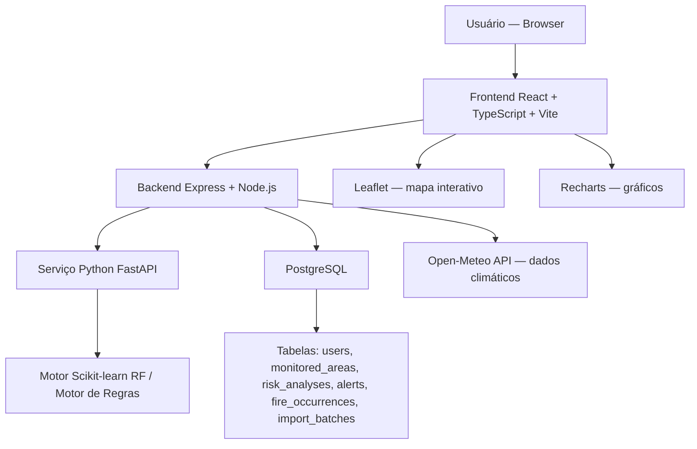

# 01 — Evidências de Maturidade Tecnológica — TRL 4

> Documento anonimizado conforme VITE_SUBMISSION_MODE.

---

## 1. Capa

| Campo | Valor |
|---|---|
| Plataforma | Plataforma Preditiva de Inteligência Ambiental |
| Subtítulo | Prevenção de incêndios em áreas produtivas e ativos territoriais |
| Versão | 1.0.0 |
| Data | Julho/2026 |
| Estágio | TRL 4 — Validação em ambiente controlado |
| Classificação | Demonstração técnica — dados sintéticos e demonstrativos |

---

## 2. Objetivo

Demonstrar que a plataforma possui arquitetura definida, protótipo funcional e componentes integrados e testados em ambiente controlado, conforme exigido para o estágio TRL 4.

---

## 3. Problema

Incêndios em áreas produtivas — agroindústrias, empresas florestais, unidades de energia, mineração, operações logísticas e instalações industriais — causam impactos ambientais, econômicos e operacionais relevantes. A ausência de sistemas preditivos integrados limita a capacidade de antecipação e resposta.

---

## 4. Solução

A plataforma integra dados ambientais, climáticos, geoespaciais e históricos para:

- classificar o risco de incêndio por área produtiva;
- identificar fatores críticos e sua contribuição individual;
- gerar alertas preventivos;
- recomendar ações antes da ocorrência;
- importar e tratar registros históricos de ocorrências.

---

## 5. Evolução do Florestaí

O CERES AI evolui a proposta original do Florestaí ao incorporar:

- tratamento estruturado de registros históricos de incêndios;
- análise preditiva de risco com fatores explicáveis;
- visualização georreferenciada de ocorrências e áreas monitoradas;
- geração de alertas e recomendações preventivas;
- rastreabilidade completa das análises realizadas.

---

## 6. Estágio Atual — TRL 4

A solução encontra-se em TRL 4 porque possui:

- arquitetura tecnológica definida e documentada;
- protótipo funcional operando em ambiente controlado;
- componentes integrados (frontend React, backend Express, serviço Python/FastAPI, banco PostgreSQL);
- entrada e processamento de dados validados;
- classificação de risco com fatores explicativos;
- visualização georreferenciada em mapa interativo;
- importação e validação de ocorrências históricas;
- geração de alertas e recomendações;
- testes automatizados executados e aprovados.

**Limitação declarada:** Os dados utilizados são sintéticos, demonstrativos ou públicos. As métricas do modelo supervisionado foram obtidas em ambiente controlado e não representam desempenho operacional definitivo.

---

## 7. Arquitetura Tecnológica



---

## 8. Fluxo Tecnológico Demonstrável

```
Entrada de dados (formulário ou arquivo)
→ Validação (campos obrigatórios, faixas, duplicidade)
→ Tratamento (normalização, padronização)
→ Processamento (motor de risco ou modelo supervisionado)
→ Classificação de risco (0–100, 4 níveis)
→ Explicação dos fatores críticos
→ Recomendações preventivas
→ Geração de alerta
→ Visualização em mapa (Leaflet)
→ Persistência (PostgreSQL)
→ Geração de relatório
→ Registro de evidências (logs, banco)
```

---

## 9. Componentes do Sistema

| Componente | Status | Evidência técnica | Arquivo ou tela | Observação |
|---|---|---|---|---|
| Frontend React/TS | Implementado | Build sem erros | client/src/ | Vite + Tailwind + shadcn/ui |
| Backend Express | Implementado | Rotas funcionais | server/routes.ts | Autenticação + APIs |
| Serviço Python FastAPI | Implementado | 104 testes aprovados | python_service/ | GET /health, POST /analyze-risk |
| Motor de regras transparente | Implementado | 34 testes aprovados | shared/risk-engine.ts | Determinístico, versão 1.0.0 |
| Modelo supervisionado (RF) | Experimental | Accuracy 84% (sintético) | python_service/models/ | Dataset sintético — não operacional |
| Banco PostgreSQL | Implementado | Tabelas criadas e populadas | shared/schema.ts | Drizzle ORM |
| Autenticação | Implementado | Login/signup/bcrypt | server/auth.ts | Sessões httpOnly |
| Mapa de risco | Implementado | Visualização Leaflet | /maps | Áreas + ocorrências |
| Alertas preventivos | Implementado | CRUD completo | /alerts | Severidade + status |
| Relatórios | Implementado | Tela funcional | /reports | Dados demonstrativos |
| Importação de ocorrências | Implementado | Fluxo CSV + validação | /data-import | Não é integração oficial |
| Fontes de dados | Implementado | Listagem + status | /data-sources | Dados demonstrativos |
| Tutorial de onboarding | Implementado | Modal + etapas | OnboardingTour.tsx | Persistência localStorage |
| Modo de submissão anônima | Implementado | VITE_SUBMISSION_MODE | shared/identity.ts | Oculta identidade dos proponentes |

---

## 10. Evidências de Testes

- TypeScript: 0 erros (`npm run check`)
- Build: aprovado (`npm run build`)
- Testes TypeScript (motor de risco): 34/34 aprovados (`npm run test:risk`)
- Testes Python (API + modelo + validação): 104/104 aprovados (`pytest python_service/tests -v`)
- Modelo supervisionado: Accuracy 84%, F1 macro 87% (dataset sintético)

---

## 11. Importação Histórica

- Fluxo implementado: upload CSV/XLS/XLSX → prévia → mapeamento de colunas → validação → tratamento → persistência
- Nenhum registro é descartado silenciosamente: todos recebem status de validação
- Rastreabilidade por lote (import_batches) e por registro (fire_occurrences)
- Aviso exibido ao usuário: importação de arquivo, não integração oficial com o Sisfogo

---

## 12. Limitações Declaradas

1. Dataset do modelo supervisionado é sintético — métricas não representam desempenho operacional.
2. Dados climáticos utilizam Open-Meteo (público) e dados demonstrativos locais.
3. Importação de ocorrências ocorre via arquivo, não por API oficial do Sisfogo.
4. A plataforma apoia decisões, mas não substitui laudos, inspeções ou protocolos oficiais.
5. Validação operacional prevista para a Prova de Valor (60 dias).

---

## 13. Riscos Técnicos

| Risco | Probabilidade | Mitigação |
|---|---|---|
| Modelo supervisionado com baixa precisão em dados reais | Alta | Motor de regras como fallback; retreinamento previsto na PoV |
| Indisponibilidade do serviço Python | Média | Fallback automático para motor TypeScript |
| Dados históricos insuficientes para treinamento | Alta | Coleta prevista durante a PoV |
| Latência na geocodificação | Baixa | Coordenadas inseridas manualmente ou via arquivo |

---

## 14. Justificativa TRL 4

A solução encontra-se em TRL 4 porque demonstra:

- Princípios tecnológicos validados (TRL 2–3): motor de risco baseado em regras documentadas
- Componentes tecnológicos integrados (TRL 4): frontend + Express + Python + banco + mapa + alertas + importação
- Testabilidade em ambiente controlado (TRL 4): 138+ testes automatizados aprovados
- Fluxo tecnológico completo demonstrável (TRL 4): da entrada de dados ao relatório

A evolução para TRL 5 está prevista para a Prova de Valor, com validação em ambiente operacionalmente relevante.

---

## 15. Conclusão

A plataforma demonstra maturidade tecnológica compatível com TRL 4. O protótipo é funcional, integrado e testável em ambiente controlado. As limitações são documentadas e não ocultadas. A Prova de Valor definirá o caminho para TRL 5–6.

---

*Todas as métricas, testes e resultados descritos neste documento foram obtidos durante a execução real do sistema em ambiente controlado. Nenhum resultado foi declarado sem execução comprovada.*
