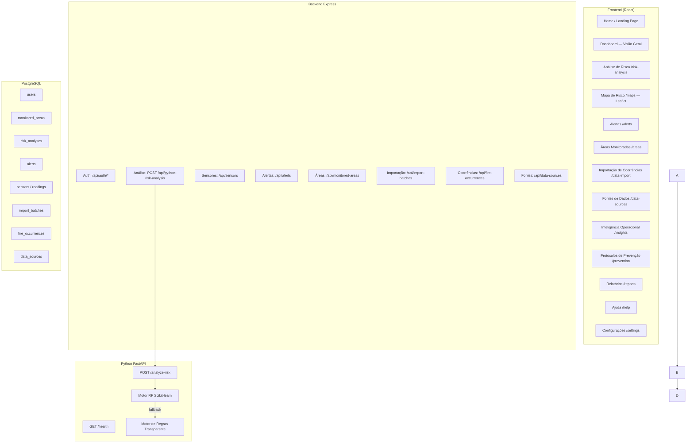

# 03 — Arquitetura Técnica — TRL 4

> Documento anonimizado.

---

## 1. Visão Geral

A plataforma utiliza arquitetura híbrida multicamada:

```
Frontend React/TypeScript (Vite)
    ↓ HTTP
Backend Express/Node.js (porta 5000)
    ↓ HTTP interno
Serviço Python/FastAPI (porta 8000)
    ↓
Motor Scikit-learn RF ou Motor de Regras Transparente
    ↓
PostgreSQL (dados persistidos)
```

---

## 2. Diagrama de Componentes



---

## 3. Fluxo de Importação de Dados Históricos

```
CSV / XLS / XLSX (upload pelo usuário)
    ↓ parseCSV (client-side)
Detecção automática de colunas
    ↓ mapeamento manual
Validação por registro (data, coords, duplicidade)
    ↓
Status por registro: válido / com ressalvas / inválido / duplicado
    ↓ POST /api/import-batches
Backend cria import_batch + fire_occurrences no PostgreSQL
    ↓
Ocorrências disponíveis no mapa e na análise de risco
```

---

## 4. Fluxo de Análise de Risco

```
Formulário de entrada (temperatura, umidade, vento, etc.)
    ↓ POST /api/python-risk-analysis
Express valida e encaminha ao Python (timeout 5s)
    ↓ POST http://127.0.0.1:8000/analyze-risk
Python: load_ml_model() → predict_with_ml_model()
    ou fallback: calculate_rule_score()
    ↓
Resposta: score, level, confidence, factors, recommendations,
          model_type, model_version, dataset_type, is_simulated
    ↓ Express salva no PostgreSQL (risk_analyses)
    ↓ Frontend exibe resultado completo
```

---

## 5. Segurança

| Mecanismo | Implementação |
|---|---|
| Hash de senha | bcrypt (salt rounds: 10) |
| Sessões | express-session + httpOnly cookies |
| Proteção de rotas | ProtectedRoute (frontend) + verificação de sessão (backend) |
| Variáveis sensíveis | SESSION_SECRET via variável de ambiente |
| Logs | Sem dados sensíveis nos logs |
| Fallback Python | Não expõe erros internos ao cliente |

---

## 6. Motor de Classificação

### Motor Transparente (model_type: "transparent-rule-engine")

Fatores e pesos documentados:

| Fator | Condição | Pontos |
|---|---|---|
| Temperatura | ≥40°C | +15 |
| Temperatura | 35–39°C | +10 |
| Temperatura | 30–34°C | +8 |
| Temperatura | 25–29°C | +4 |
| Umidade | ≤20% | +15 |
| Umidade | 21–40% | +10 |
| Umidade | 41–60% | +8 |
| Vento | ≥40km/h | +10 |
| Vento | 20–39km/h | +6 |
| Precipitação | 0mm | +5 |
| Precipitação | >30mm | −5 |
| Vegetação | Muito seca | +15 |
| Vegetação | Seca | +10 |
| Vegetação | Moderada | +4 |
| Foco próximo | <5km | +20 |
| Foco próximo | 5–15km | +12 |
| Histórico | Alto (>5) | +10 |
| Histórico | Moderado (3–5) | +5 |
| Histórico | Baixo (1–2) | +2 |

Score limitado a 0–100. Classificação: 0–24 (baixo), 25–49 (moderado), 50–74 (alto), 75–100 (crítico).

### Modelo Supervisionado (model_type: "supervised-ml")

- Algoritmo: RandomForestClassifier (Scikit-learn)
- Features: 9 (temperatura, umidade, vento, precipitação, vegetação, foco, distância, histórico, qualidade dos dados)
- Classes: baixo, moderado, alto, crítico
- Dataset: sintético (2.000 amostras geradas pelo motor de regras)
- Limitação: não validado com dados operacionais reais

---

## 7. Tecnologias Reais Utilizadas

| Camada | Tecnologia | Versão |
|---|---|---|
| Frontend | React | 18.x |
| Frontend | TypeScript | 5.6 |
| Frontend | Vite | 7.x |
| Frontend | Tailwind CSS | 3.x |
| Frontend | shadcn/ui | Componentes |
| Frontend | Leaflet | 1.9 |
| Frontend | Recharts | Gráficos |
| Frontend | TanStack Query | 5.x |
| Backend | Node.js | 20.x |
| Backend | Express | 4.x |
| Backend | Drizzle ORM | 0.39 |
| Backend | bcrypt | 6.x |
| Banco | PostgreSQL | 16 |
| Python | FastAPI | 0.115 |
| Python | Scikit-learn | 1.x |
| Python | Pandas | 2.x |
| Python | NumPy | 1.x |
| Python | Pydantic | 2.x |
| Python | Joblib | 1.x |
| Python | Pytest | 7.x |

---

## 8. Variáveis de Ambiente

| Variável | Finalidade | Obrigatória |
|---|---|---|
| DATABASE_URL | Conexão com PostgreSQL | Sim |
| SESSION_SECRET | Segredo das sessões | Sim |
| PYTHON_SERVICE_URL | URL do FastAPI (padrão: http://127.0.0.1:8000) | Não |
| VITE_SUBMISSION_MODE | Modo de submissão anônima | Não |

---

## 9. Limitações Arquiteturais

1. Modelo supervisionado treinado com dados sintéticos
2. Importação de ocorrências via arquivo (não API em tempo real)
3. Dados climáticos externos dependem de conectividade com Open-Meteo
4. Sem integração com sistemas de alertas externos (SMS, e-mail) nesta fase
5. Sem streaming de dados de sensores IoT reais nesta fase
